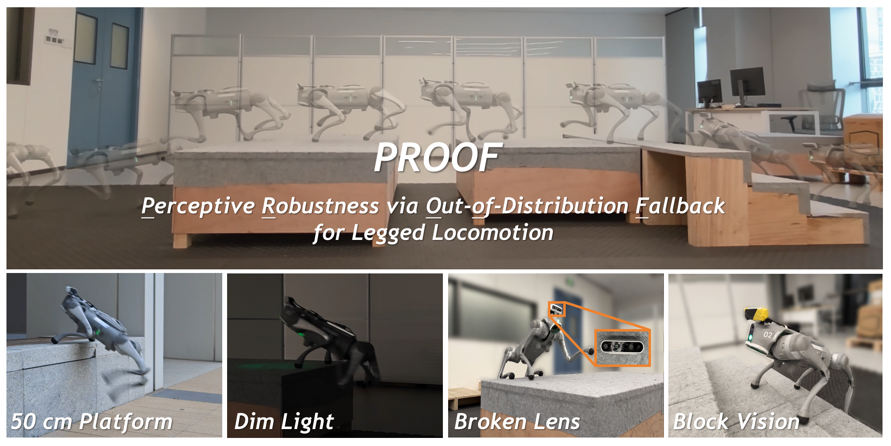
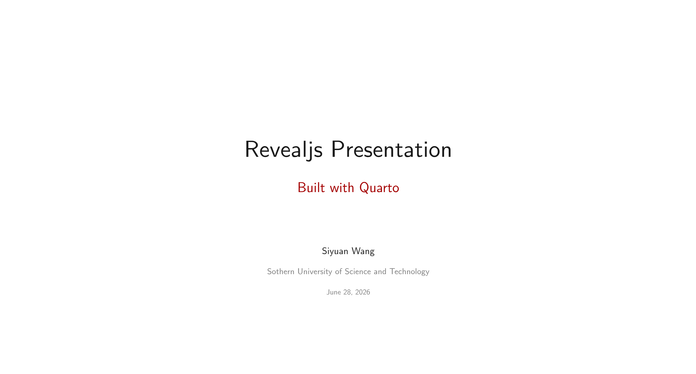
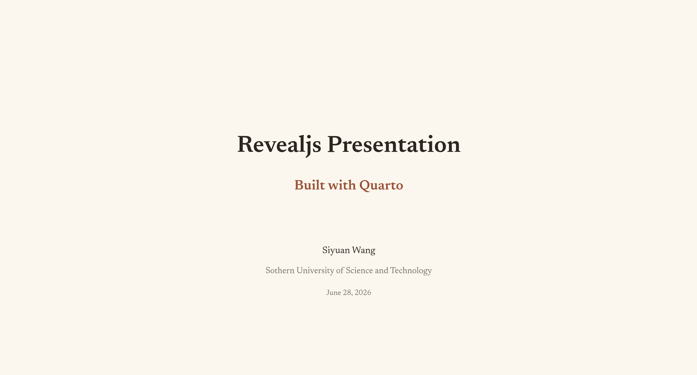
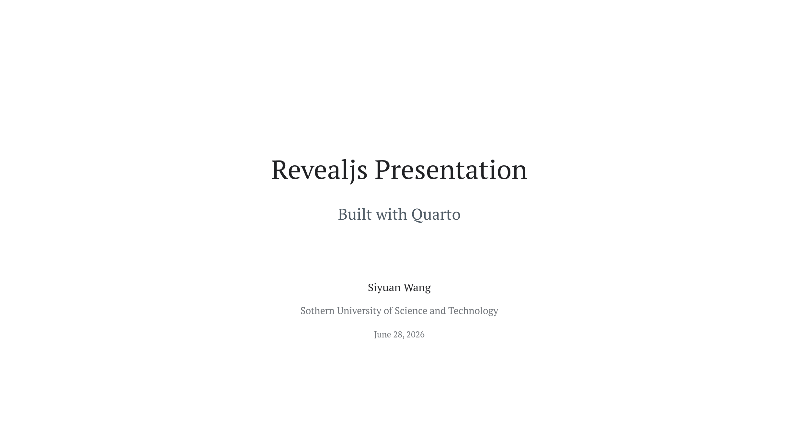
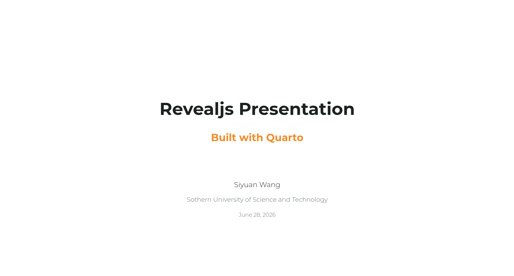

<p align="center">
    <h2 align="center"> Quarto Template
    </h2>
</p>

<p align="center" style="text-decoration: none; border: none; margin-bottom: 10px;">
    
    
</p>


<br>


## :cherry_blossom: Introduction

- This repo hosts my [Quarto](https://neovim.io/) `revealjs` template for presentation. 
- **Check the template configured for documentation (`html` and `pdf`) at [here](https://github.com/syw-robotics/quarto_template/tree/doc).** 
- [**Click to preview this template**](https://syw-robotics.github.io/quarto_template/main.html)

## 创建独立演示项目

安装一次命令行入口后，可以在任意新目录创建演示项目。新项目约 1.2 MiB，自带主题、可视化编辑器和导出脚本。各项目通过 `assets/fonts` 符号链接共用本机 qpre 安装目录中的字体。正文、文献库、上传素材和排版记录都保存在项目目录内。

```bash
# 在本仓库中安装入口（~/.local/bin 需在 PATH 中）
mkdir -p ~/.local/bin
ln -s "$PWD/bin/qpre" ~/.local/bin/qpre

qpre new ~/talks/lab-meeting
cd ~/talks/lab-meeting
./preview.sh --edit
```

在 `main.qmd` 设置标题和章节顺序，在 `sections/intro.qmd` 编写正文。把图片、视频、字幕等放进 `assets/media/`，从 QMD 使用项目相对路径，例如 ``。可视化编辑器上传的素材会自动随项目导出。

```bash
# 从已保存的源码和布局重新渲染并打包
qpre portable-html main.qmd
```

把整个 `exported_html/` 目录复制到另一台电脑，用现代浏览器直接打开其中的 `main.html` 即可放映。目录内包含 Reveal.js、使用的本地字体、排版和原始媒体。接收方只需要浏览器。离线使用的视频或网页素材应先保存到项目中。在另一台电脑继续编辑源码时，将项目的 `assets/fonts` 符号链接指向该机 qpre 安装目录中的 `assets/fonts`。

要把**创建工具**带到另一台编写电脑，在仓库中运行 `bin/qpre pack qpre.tar.gz`。解压后将 `qpre/bin` 加入 PATH 即可使用。工具包包含通用模板，创建和编辑需要 Bash、Python 3.9+ 和 Quarto。

### Markdown 组件

标签按版式或用途命名，可以跨章节使用。

| 想表达的内容 | Markdown 标签 |
| --- | --- |
| 左右两栏 | `.two-columns`，加 `.wide-left` 或 `.wide-right` 可指定较宽的一栏 |
| 简单图文概览 | `.text-column` 放正文，`.image-panel` 放配图 |
| 并排的短文字卡片 | `.cards` 包住一个无序列表 |
| 包含视频、状态或说明的卡片 | `.card-grid` 包住若干 `.card`，卡内可放 `.card-header`、`.status`、`.card-note` |
| 推导与计划 | `.equation` 放公式，`.schedule-table` 放计划表 |

卡片标题和状态可以写在同一行。

```markdown
::: {.card-header}
**感知鲁棒性** [已开展]{.status}
:::
```

同一个 `.gallery` 接受图片和视频。链接文字在图片下方显示为图注，在视频画面内显示为标签。示例取自主稿素材。

```markdown
::: {.gallery}
- [方法流程](assets/kaiti/proof/proof_method-pipeline.png)
- [跨越沟壑](assets/kaiti/proof/sim/sim_gap_stage-web.mp4)
:::
```

并排比较视频使用 `.video-pair`。每一项写成视频链接，`.bad` 和 `.good` 分别显示 × 和 ✓，与标题共用一个标签。行末加反斜杠可另起图注，图注支持 Markdown 引用。普通视频可省略状态，链接文字会显示在视频下方。多片源视频可在链接后写 `{poster="封面.jpg" fallback="备用.mp4"}`。

```markdown
::: {.video-pair}
- [Baseline End-to-End Policy](assets/kaiti/proof/real-world/65-real-motivation-e2e-web.mp4){.bad}\
  Baseline在视觉干扰下导致策略出现危险行为[@zhuang_robot_parkour_learning_2023;@cheng_extreme_2023]
- [PROOF Policy](assets/kaiti/proof/real-world/65-real-motivation-proof-web.mp4){.good}\
  PROOF保持敏捷跑酷能力的同时对视觉干扰具有鲁棒性
:::
```

在画布上双击图注，或在右侧「文字内容」中输入 `@`、`[@` 和关键词，可搜索工程文献库。单击候选，或用 ↑ ↓ 和 Enter 选择。已有引用组后输入 `;@` 可追加文献。正文和引用在同一个编辑框中，Backspace 可一次删除光标前的整组引用。保存会把带引用键的文字写入 `assets/layout/edits.js`，放映时显示编号，新增引用会补到参考文献页。手写稿件时可直接编辑 QMD 中的 `[@键一;@键二]`。

方法流程使用 `.steps` 和 Markdown 有序列表。加上 `.across` 可横排。研究路线使用 `.tracks`，在编号上标记 `.current` 即可突出本节。

```markdown
::: {.steps}
1. **训练 Teacher**。使用仿真中的地形信息。
2. **蒸馏 Student**。使用机载深度相机的观测。
:::

::: {.tracks}
- [一]{.index .current} **融合外部感知的运动策略**\
  感控一体的运动策略 {.nolightbox}
:::
```

并排文字卡片使用 `.cards` 和无序列表，每项可用粗体标题和换行添加说明。带标注的 SVG 可用 `{.inline-svg}` 引入，画布中仍可单独选中图内文字。

两栏正文用围栏区块组织，实验数据和研究计划使用 Markdown 管道表格。可在 [研究背景](sections/bg.qmd)、[方法与结果](sections/proof.qmd) 和 [研究路线](sections/rp-toc.qmd) 中直接复制完整示例。

## :page_with_curl: Scripts

- `bin/qpre`:
    - global entry for rendering a single `.qmd` slide file from any directory with this template.
    - install once:
      ```bash
      ln -sf "$PWD/bin/qpre" ~/.local/bin/qpre
      ```
      Make sure `~/.local/bin` is in `PATH`.
    - usage:
      ```bash
      qpre talk.md
      qpre preview talk.md --port 6111
      qpre pdf talk.md
      qpre portable-html talk.md
      ```
    - if this repo moves, either recreate the symlink or set:
      ```bash
      export QPRE_TEMPLATE_DIR=/path/to/quarto_template
      ```
    - template theme aliases are `default`, `claude`, `minimal`, and `sustech`.
- `clear.sh`:
    - clear exported files. 
    - also available through `qpre clear`.
- `preview.sh`
    - preview rendered html.
- `export_pdf.sh`
    - render the Quarto `revealjs` deck and export a selectable-text PDF through the same Revealjs print view used by the HTML output.
    - requires `quarto`, `node`, and a Chrome/Chromium-compatible browser in `PATH`.
    - usage: `./export_pdf.sh` or `./export_pdf.sh your-slide.qmd`.
    - if the browser is not auto-detected, set it explicitly: `CHROME_BIN=microsoft-edge ./export_pdf.sh`.
    - the PDF exporter implementation lives in `assets/export_reveal_pdf.mjs`; the project root keeps only the `export_pdf.sh` entry script.
    - the exporter preserves internal cross-reference links, selectable text, custom footers, Revealjs slide numbers, and expands tabsets so each tab is included in the PDF.
- `export_portable_html.sh`
    - bundles the selected English + Chinese fonts from `assets/fonts/` into `exported_html/assets/fonts/`.
    - recursively bundles images and videos from `assets/`, preserving nested paths such as `assets/kaiti/proof/`.
    - all fonts are self-contained — no dependency on locally installed fonts or internet access.
    - run it after `quarto render` to make the HTML portable to any machine.
    - `export_pdf.sh` runs this step automatically after rendering.
    - to present offline, copy the rendered `.html` file together with its matching `*_files` directory and any project assets you reference, such as `assets/`.

## Theme config

- `assets/themes/default.scss` is the default theme entry.
- More theme details are available in [`assets/themes/README.md`](assets/themes/README.md).
- Theme entries are in `assets/themes/`:
    - [`assets/themes/default.scss`](https://syw-robotics.github.io/quarto_template/default/)
    - [`assets/themes/claude.scss`](https://syw-robotics.github.io/quarto_template/claude/)
    - [`assets/themes/sustech.scss`](https://syw-robotics.github.io/quarto_template/sustech/)
    - [`assets/themes/minimal.scss`](https://syw-robotics.github.io/quarto_template/minimal/)


| Theme | Preview | Fonts | Character |
| --- | --- | --- | --- |
| [`default.scss`](https://syw-robotics.github.io/quarto_template/default/) | [](https://syw-robotics.github.io/quarto_template/default/) | Latin Modern Sans + LXGW WenKai | Clean default academic style with red accents and bracket footnotes. |
| [`claude.scss`](https://syw-robotics.github.io/quarto_template/claude/) | [](https://syw-robotics.github.io/quarto_template/claude/) | Newsreader + Source Han Sans SC | Warm style inspired by Claude/Anthropic colors, with serif Latin typography and soft rust accents. |
| [`minimal.scss`](https://syw-robotics.github.io/quarto_template/minimal/) | [](https://syw-robotics.github.io/quarto_template/minimal/) | PT Serif + Noto Sans CJK SC | Neutral compact style for dense technical presentations. |
| [`sustech.scss`](https://syw-robotics.github.io/quarto_template/sustech/) | [](https://syw-robotics.github.io/quarto_template/sustech/) | Montserrat + Noto Sans CJK SC | SUSTech university style with green and orange accents. |


- To switch themes, change the Revealjs theme entry in your `.qmd` file:

    ```yaml
    format:
      revealjs:
        theme: assets/themes/claude.scss
    ```
    With `qpre`, you can also use the shorter alias:
    ```yaml
    format:
      revealjs:
        theme: claude
    ```

- Theme font selection is controlled at the top of each theme entry:
    ```scss
    $theme-font-en: "Latin Modern Sans";
    $theme-font-cn: "LXGW WenKai";
    ```
    The theme imports the matching local font CSS automatically.

- Slide footnote markers created with `^[...]` use superscript by default.

    To change them globally, set:
    ```scss
    $theme-footnote-mode: "sup"; // sup, bracket, badge, hidden
    ```

    To change one slide only, add `{.footnote-bracket}`, `{.footnote-badge}`, or `{.footnote-hidden}` to that slide header.

    e.g.
    ```markdown
    ## Slide Title {.footnote-bracket}
    ```
